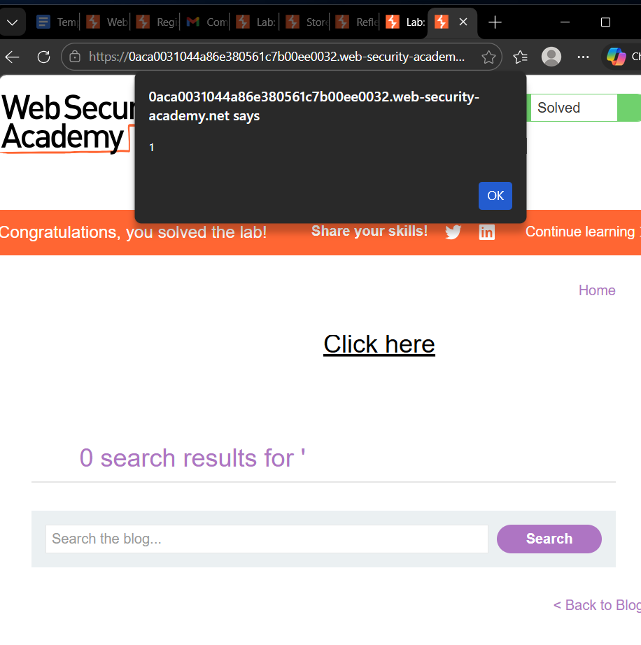
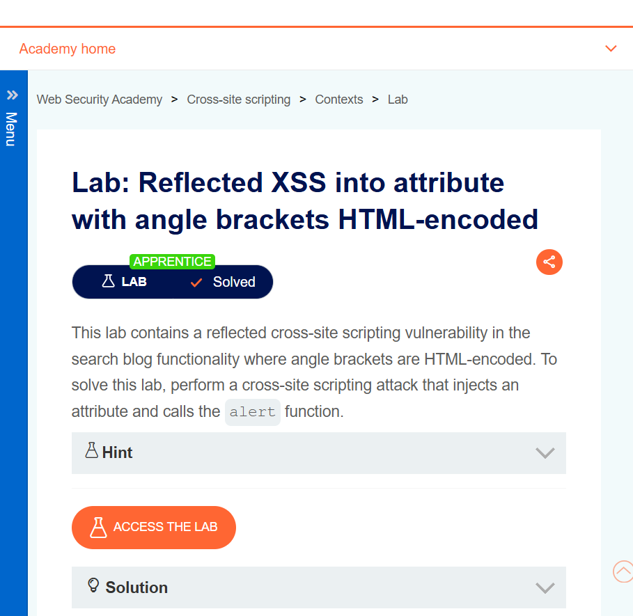
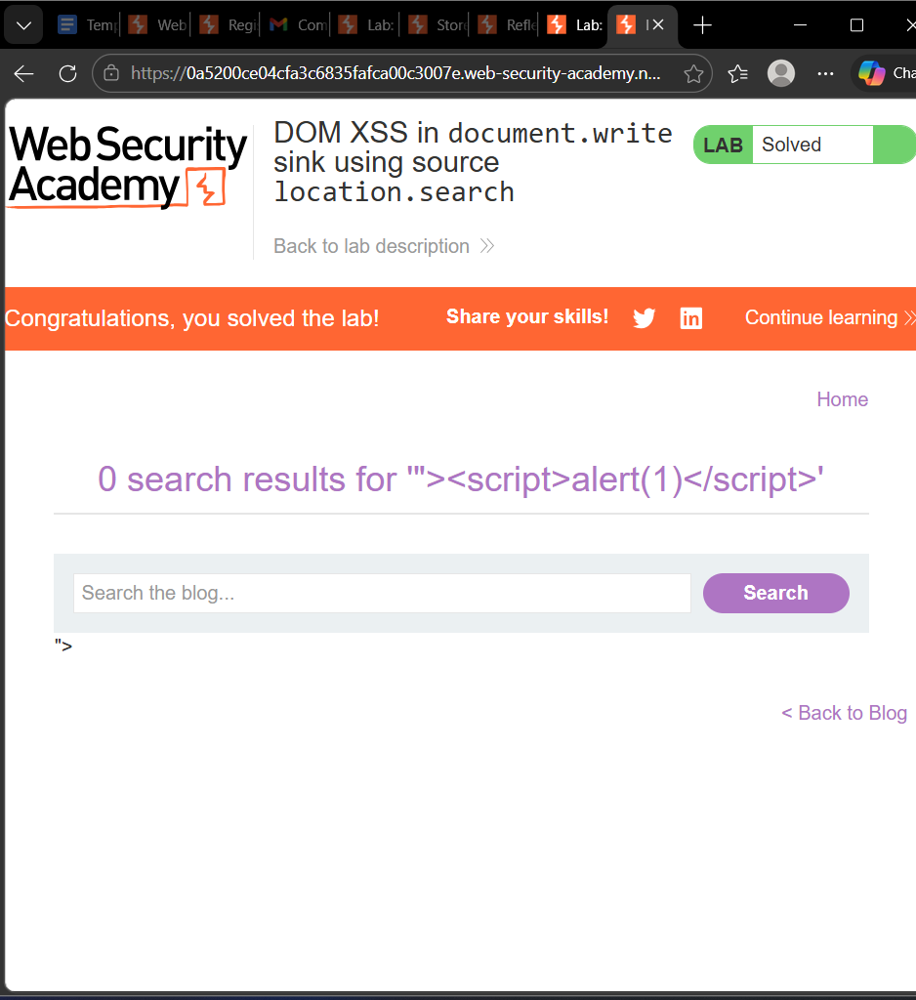
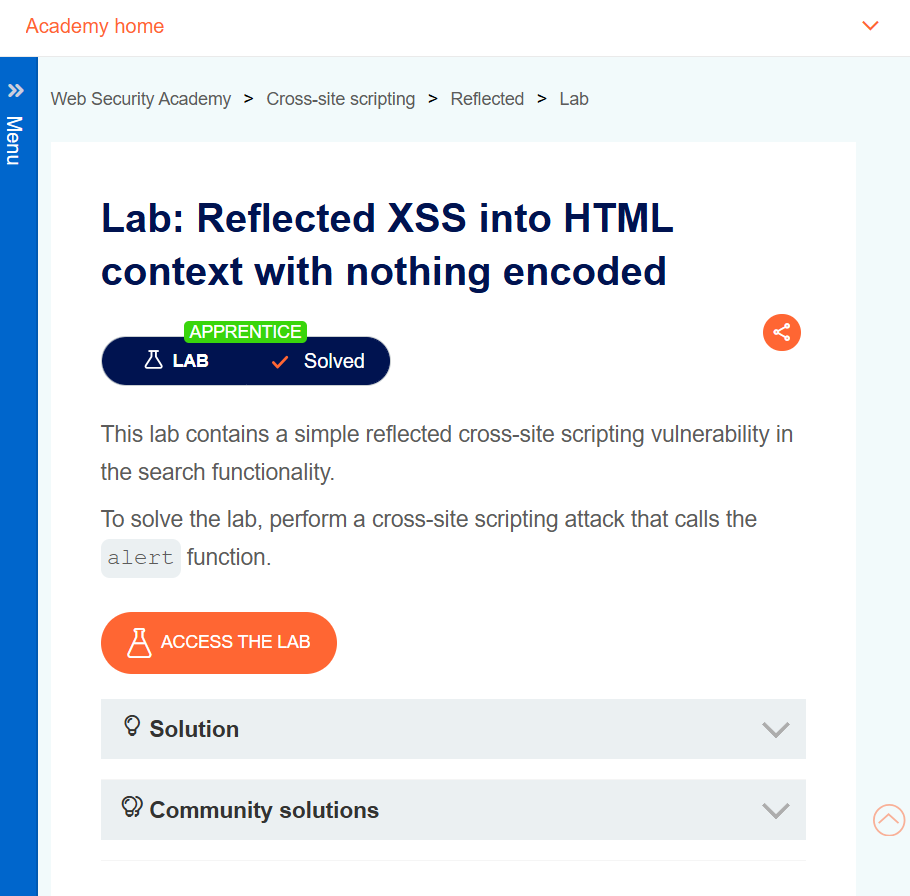

# PortSwigger Web Security Academy: XSS Labs

Notes from solving Cross-Site Scripting labs on PortSwigger's Web Security Academy, covering Reflected, Stored and DOM-based XSS.

## Objective
Learn how different XSS types arise, how input is rendered in different contexts (HTML, attribute, JavaScript), and how filters can be bypassed.

## Tools
Burp Suite · Browser Developer Tools · PortSwigger Web Security Academy · Kali Linux

## Labs Completed

| # | Lab | Type | Context |
|---|-----|------|---------|
| 1 | Reflected XSS with event handlers and `href` attributes blocked | Reflected | Filter bypass |
| 2 | Reflected XSS into attribute with angle brackets HTML-encoded | Reflected | HTML attribute |
| 3 | DOM XSS in `document.write` sink using source `location.search` | DOM-based | JavaScript sink |
| 4 | Stored XSS into HTML context with nothing encoded | Stored | HTML body |
| 5 | Reflected XSS into HTML context with nothing encoded | Reflected | HTML body |

## Approach
1. Identify where user input is reflected or stored.
2. Determine the context (HTML body, attribute, JS string, DOM sink).
3. Use Burp Suite and DevTools to inspect requests and the DOM.
4. Craft a payload that fits the context and avoids the filter.
5. Confirm execution and note why the flaw exists.

## Key Learnings
- The injection **context** decides which payload works.
- Blacklist filters (blocked tags or events) are often bypassable; output encoding is the real fix.
- DOM XSS occurs entirely in client-side code, so checking the server response alone is not enough.

## Prevention Summary
Context-aware output encoding, input validation, avoiding dangerous sinks (`document.write`, `innerHTML`), and a strong Content-Security-Policy.

## Screenshots
**Lab 1: Reflected XSS, event handlers and href blocked**

**Lab 2: Reflected XSS into attribute, angle brackets encoded**

**Lab 3: DOM XSS in document.write sink**

**Lab 4: Stored XSS, nothing encoded**

**Lab 5: Reflected XSS, nothing encoded**

> Solutions are intentionally not reproduced here so the labs stay useful for other learners.
